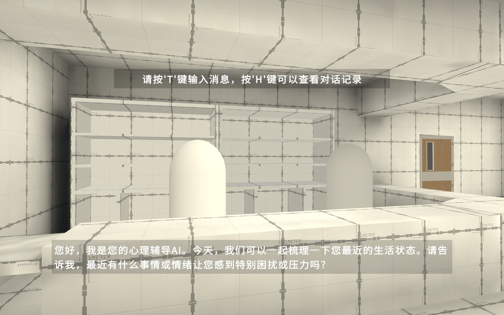
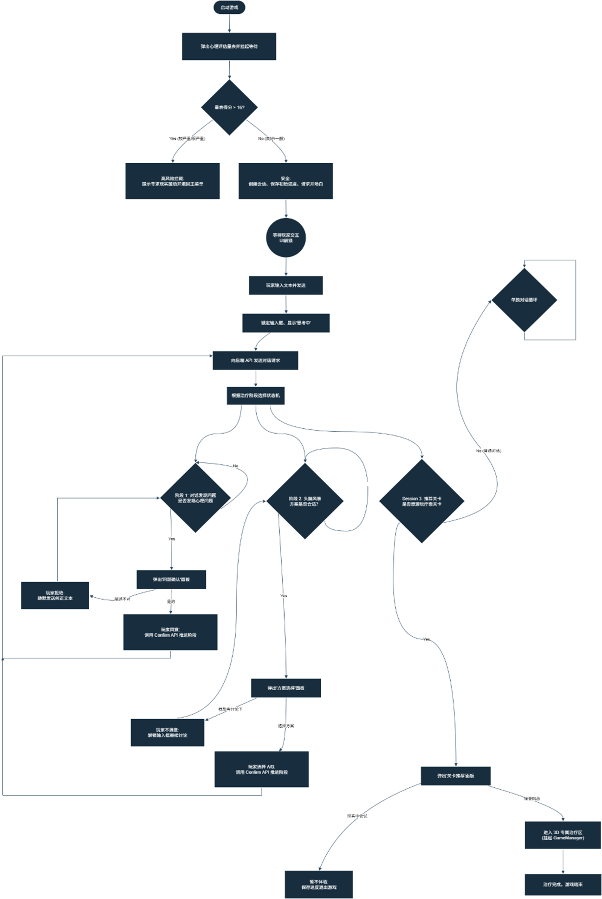
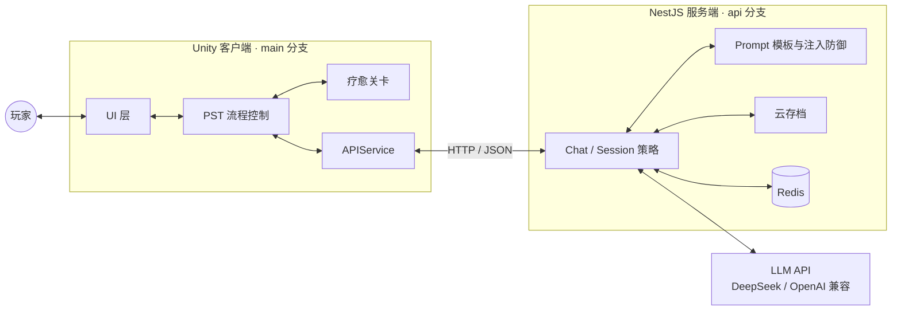
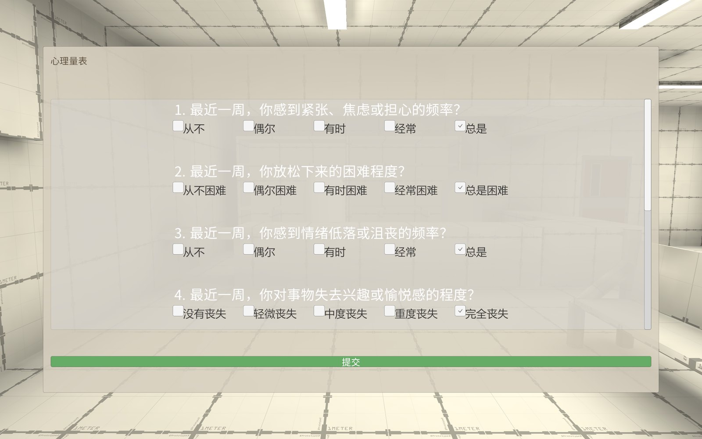
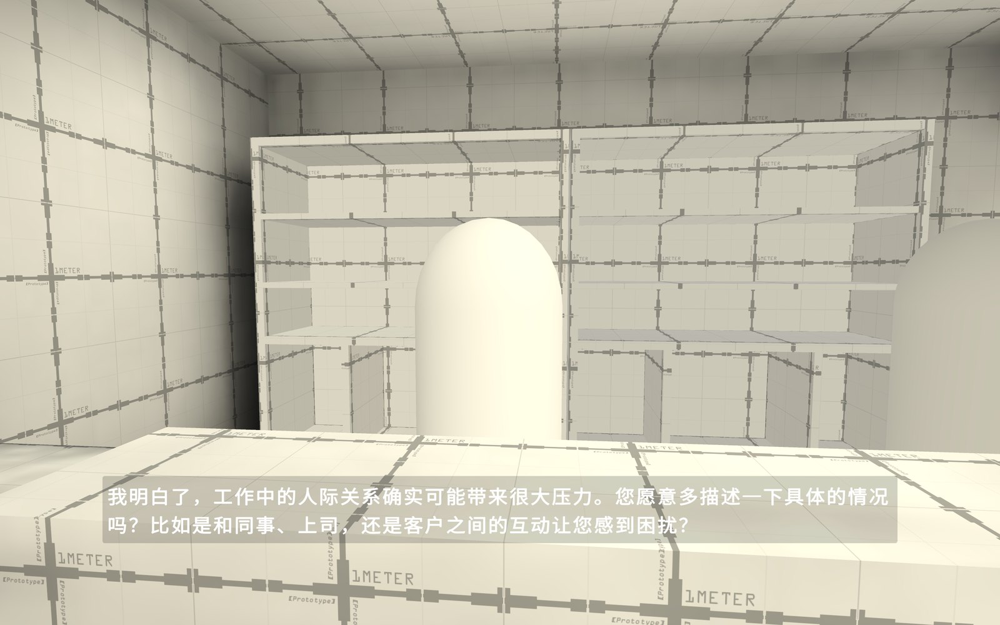
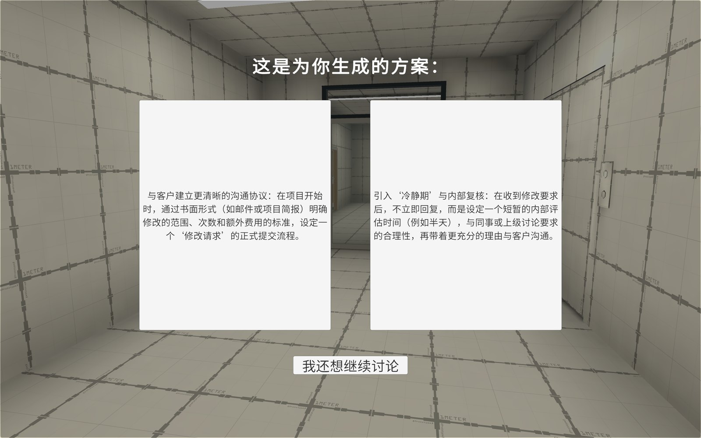
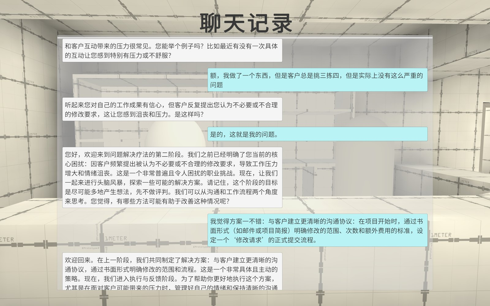
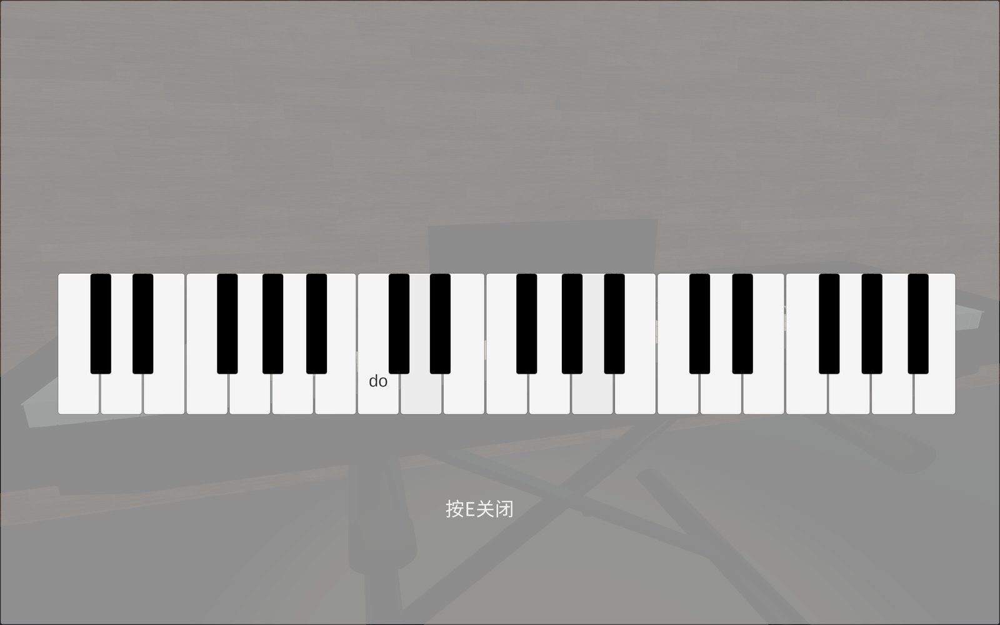
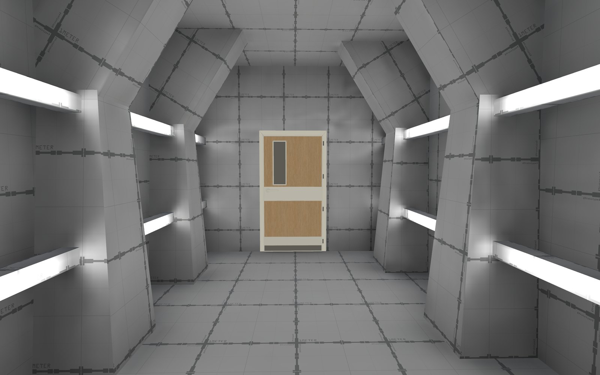
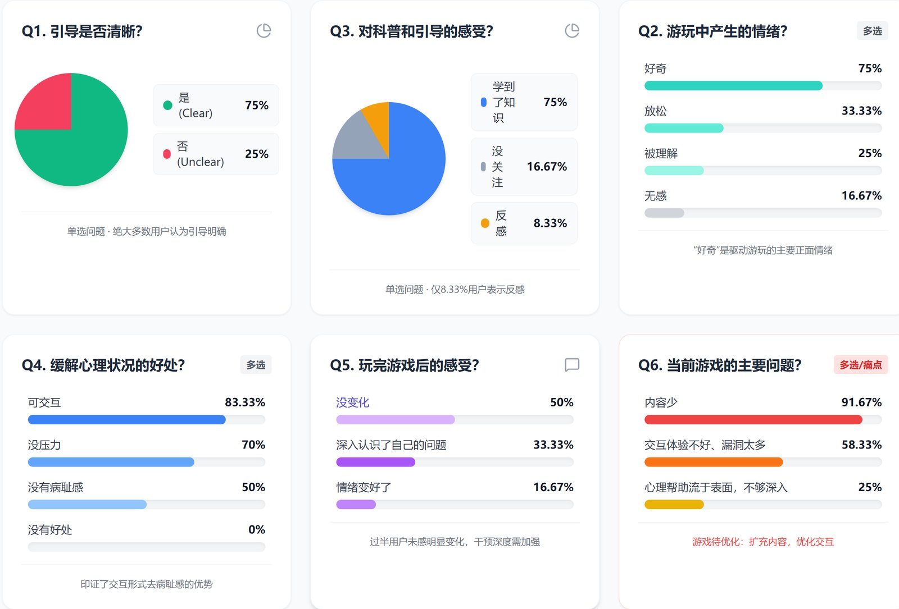

<div align="center">

# 聊愈 · ChatHealing

**AI 驱动的自适应问题解决疗法（PST）严肃游戏**

将大语言模型与问题解决疗法结合，让 AI 虚拟心理医生以苏格拉底式提问，
陪玩家完成一次「发现问题 → 构思方案 → 选择方案 → 疗愈体验」的完整疗程。

[](https://unity.com/)
[](https://nestjs.com/)
[](https://www.typescriptlang.org/)
[](https://learn.microsoft.com/dotnet/csharp/)
[]()



</div>

---

## 目录

- [项目简介](#项目简介)
- [核心设计](#核心设计)
- [游戏流程](#游戏流程)
- [系统架构](#系统架构)
- [界面展示](#界面展示)
- [本地运行](#本地运行)
- [测试与反馈](#测试与反馈)
- [项目信息](#项目信息)
- [已知限制与安全声明](#已知限制与安全声明)
- [致谢](#致谢)

## 项目简介

在心理健康领域，传统线下心理咨询存在明显的现实壁垒：一方面，存在轻度心理困扰的人群常因担心被贴标签而产生较高的病耻感，不愿主动求助；另一方面，专业咨询费用较高，且受时空限制，普通群体难以获得及时的心理疏导。

严肃游戏（Serious Games）为心理干预提供了新的可能——游戏可以营造安全、无评判的虚拟环境，弱化用户的心理防御。但现有医疗类严肃游戏大多依赖预先写好的脚本，缺乏针对具体问题的自适应能力；大语言模型与严肃游戏的结合，在医疗领域仍处于早期探索阶段。

「聊愈」由此而生。项目以**问题解决疗法（Problem-Solving Therapy, PST）**为理论蓝本，以大语言模型为自适应引擎，构建了一款前后端解耦的心理类严肃游戏。玩家不必配置 API Key，打开客户端联网即可进入一段约 15–45 分钟的完整体验：在极简、安静的 3D 空间里，由 AI 虚拟心理医生主动引导，逐步说清困扰、生成并选择适合自己的解决方案，最后进入对应的疗愈关卡。

项目的目标不是替代专业治疗，而是探索一条**低成本、低病耻感、易坚持**的数字化心理干预路径，并为「大模型 + 严肃游戏 + 心理疗法」这一交叉方向积累可复用的工程与设计经验。

> 本项目为复旦大学本科生学术研究资助计划（FDUROP）**曦源项目（编号 254356）**，由计算与智能创新学院杨世坤、万明浩共同完成，指导教师为徐迎晓。

## 核心设计

### 1. 以 PST 为骨架的阶段化流程

PST 是一种短程、结构化、以解决问题为中心的心理治疗方法，其「定义问题 → 构思方案 → 评估选择 → 执行反馈」的模块化流程与游戏关卡设计高度契合，且单次疗程时长适中、几乎无负面副作用。

游戏将 PST 拆解为四个阶段（阶段零至阶段三），每个阶段都有明确的进入条件、AI 行为与玩家确认节点：

| 阶段 | 目标 | 关键机制 |
| --- | --- | --- |
| **阶段零：安全评估** | 在进入疗程前完成风险筛查 | 整合 GAD-7、PHQ-9、PHQ-15 的自评量表；得分超过安全阈值（>16）时触发高风险拦截，温和提示寻求现实专业援助并退回主菜单 |
| **阶段一：发现问题** | 锁定玩家近期最困扰的核心问题 | AI 以苏格拉底式提问逐步澄清；识别到问题后弹出确认面板，玩家确认后进入下一阶段 |
| **阶段二：构思方案** | 与玩家共同头脑风暴现实可行的应对方案 | AI 结合大模型推理给出两个及以上备选方案；玩家可表示不满意并继续讨论、重新生成 |
| **阶段三：疗愈体验** | 将选定的方案转化为沉浸式互动 | 根据方案推荐疗愈关卡（正念冥想 / 音乐之旅），挂载对应 GameManager，完成后温和结束疗程 |

### 2. 苏格拉底式 AI 引导

项目参考 SocraSynth 等多智能体推理思路，把传统「人主导、AI 应答」的对话范式反过来：由 AI 虚拟医生智能体以苏格拉底式提问主动推进对话，温和地引导玩家剖析自我。服务端按疗程阶段拆分策略（Session 1/2/3），由大模型根据玩家输入实时生成问题、问题总结、备选方案与关卡推荐，从而实现针对具体困扰的「千人千面」自适应干预，而不是穷举预设分支。

### 3. 安全边界与内容防护

心理干预场景对安全性要求极高，项目在多个层面设置了边界：

- **前置筛查**：GAD-7、PHQ-9、PHQ-15 组合量表，配合高风险拦截机制；
- **提示词防御**：服务端构建语义分析防注入的系统提示词，抵御提示词注入、越狱与角色扮演攻击；
- **伦理约束**：系统提示词明确禁止下达医学诊断或建议药物治疗，遇到自残、自杀等危机表达时必须停止普通流程并建议寻求现实专业帮助。

### 4. 极简留白的美术风格

游戏对大部分场景采用无纹理贴图的「白模」渲染，再结合 Unity 的光照烘焙与全局光照（GI），呈现超现实的梦境质感。这种「去视觉噪音」的策略既是有限美术资源下的取舍，也服务于核心目标：避免玩家注意力被场景细节分散，把注意力留在对话与自我审视上，营造一个安全、无压力的「心理宣泄室」。

## 游戏流程

<div align="center">
  
</div>

客户端与服务端通过阶段确认接口推进流程。每个阶段结束时，客户端会调用 `confirm-stage` 提交当前问题或方案，服务端切换到下一阶段的策略与提示词；玩家也可以在对话中回顾历史、重新讨论方案或重新定义问题。

## 系统架构



### 客户端（`main` 分支）

基于 **Unity 2022.3.62f1c1**（默认渲染管线）开发。客户端通过大量模块化 C# 脚本，把 UI、PST 流程逻辑与关卡切换解耦：

| 模块 | 主要文件 | 职责 |
| --- | --- | --- |
| 流程控制 | `Assets/Script/Managers/TherapyGameManager.cs` | 管理阶段状态、场景切换与疗程生命周期 |
| UI | `Assets/Script/Managers/TherapyUIManager.cs` | 量表、对话、方案、提示等界面状态 |
| AI 对话 | `Assets/Script/Managers/AIChatManager.cs` | 对话请求、流式展示、历史记录 |
| 旁白与引导 | `Assets/Script/Managers/NarratorManager.cs` | 开场旁白、阶段引导 |
| 网络层 | `Assets/Script/Services/APIService.cs` | 与服务端通信、DTO 序列化 |
| 存档 | `Assets/Script/LocalSaveSystem.cs` | 本地存档与云存档同步 |
| 关卡 | `Assets/Script/Managers/TherapyLevelManager.cs`、`GameConfig.cs` | 关卡注册、推荐与加载 |
| 交互 | `Assets/Script/PlayerInteraction.cs`、`Assets/Script/Interface/` | 可交互物体基类、门、钢琴等 |
| 场景触发 | `Assets/Script/Triggers/` | 引导、开门、彩蛋等事件 |
| 编辑器工具 | `Assets/Script/Editor/` | 批量加碰撞体、预制体生成、UV 检查 |

主要依赖：UniTask、Newtonsoft.Json、TextMeshPro、ProBuilder、Cinemachine。

### 服务端（`api` 分支）

服务端位于同一仓库的 **`api` 分支**，基于 **NestJS 11 + TypeScript**，使用 Redis 作为会话与缓存数据层，并通过 OpenAI 兼容 SDK 调用大模型：

- **会话策略**：`session-1` / `session-2` / `session-3` 分别对应发现问题、头脑风暴与关卡推荐，由 `strategy.factory.ts` 统一调度；
- **结构化输出**：要求模型返回 JSON（`dialogue`、`problem`、`solution_1/2`、`recommended_level`），客户端据此驱动 UI 与流程；
- **提示词防御**：`config/default_config.json` 中的 `prompt_prefix` 定义了不可覆盖的系统级安全指令；
- **云存档**：按 `chatId` 保存对话历史与疗程进度，支持断点续玩；
- **API 文档**：`/chats`、`/saves`、`/prompts` 三组接口，详见 `api` 分支的 `README.md`。

> 服务端按同时在线 500+ 用户的目标进行架构设计，实际容量取决于部署机器、Redis 与模型 API 的配额。

### 仓库分支

| 分支 | 内容 |
| --- | --- |
| `main` | Unity 客户端（默认分支） |
| `api` | NestJS 服务端 |

如需同时获取两端代码，建议分别克隆：

```bash
git clone -b main https://github.com/SatellIta/XiYuanProject.git
git clone -b api  https://github.com/SatellIta/XiYuanProject.git XiYuanServer
```

## 界面展示

<table>
  <tr>
    <td align="center"></td>
    <td align="center"></td>
  </tr>
  <tr>
    <td align="center">阶段零 · 心理量表评估与安全筛查</td>
    <td align="center">阶段一 · AI 以苏格拉底式提问引导</td>
  </tr>
  <tr>
    <td align="center"></td>
    <td align="center"></td>
  </tr>
  <tr>
    <td align="center">阶段二 · 大模型生成两个备选方案</td>
    <td align="center">玩家可随时回顾完整对话记录</td>
  </tr>
  <tr>
    <td align="center"></td>
    <td align="center"></td>
  </tr>
  <tr>
    <td align="center">阶段三 · 音乐演奏疗愈关卡</td>
    <td align="center">极简留白的疗愈空间</td>
  </tr>
</table>

## 本地运行

### 环境要求

- **Unity** 2022.3.62f1c1（Unity 2022.3 LTS；使用 Unity Hub 安装对应版本）
- **Git LFS**：仓库中的 `.fbx` 模型通过 Git LFS 管理
- **Node.js** 20+（服务端）
- **Redis** 6+（服务端，默认 `localhost:6379`）
- 一个 OpenAI 兼容的大模型 API（默认配置为 DeepSeek）

### 运行客户端

```bash
git lfs install
git clone -b main https://github.com/SatellIta/XiYuanProject.git
```

1. 用 Unity Hub 打开项目根目录；
2. 打开 `Assets/Scenes/MainMenu.unity`；
3. 点击 Play。

客户端默认请求的服务端地址定义在 `Assets/Script/Services/APIService.cs` 的 `BaseUrl` 常量中。若使用自建服务端，请将其改为对应地址（本地调试可用 `http://localhost:3000`）。

### 运行服务端

```bash
git clone -b api https://github.com/SatellIta/XiYuanProject.git XiYuanServer
cd XiYuanServer
npm install

# 复制默认配置后填入自己的模型参数
cp config/default_config.json config/config.json
# 编辑 config/config.json：
#   baseURL  例如 https://api.deepseek.com
#   apiKey   你自己的 API Key
#   model    例如 deepseek-chat

# 启动 Redis（默认 localhost:6379）
redis-server

# 开发模式启动服务端
npm run start:dev
```

服务端默认监听 `3000` 端口。启动后，将客户端的 `BaseUrl` 指向该服务端即可。

### 关于官方联网版本

项目曾提供 Windows 安装包 `ChatHealing_Setup.exe` 用于小规模试玩。由于游戏需要联网，而 Windows 默认不会为未注册程序放行入站规则，安装包会自动注册入站规则，卸载程序也会一并清理。

> 项目服务器为腾讯云轻量应用服务器，租期已于 **2026 年 8 月**到期。在线服务可能已不可用，建议通过上述方式本地部署体验。

## 测试与反馈

项目在初版完成后邀请了部分参与者试玩，并发放问卷收集主观反馈。以下为小样本调查结果，**并非临床对照试验**，仅用于验证交互设计与流程可行性：

<div align="center">
  
</div>

- **科普与引导**：75% 的参与者表示在游玩过程中学到了心理知识，并感受到了明确引导；17% 未明显关注到心理学元素；8% 对干预内容感到反感。
- **去病耻感体验**：83% 认为该形式「可交互、没有压力」；50% 表示「完全没有传统心理咨询的病耻感」。
- **待改进问题**：58% 的反馈提到偶发的交互漏洞；92% 认为当前游戏内容体量偏少，希望进一步扩充关卡与对话内容。

这组数据初步支持了「模块化流程 + 配置驱动 + 大模型自适应」的思路，但也明确暴露了内容体量与交互稳定性的不足。

## 项目信息

| 项目 | 信息 |
| --- | --- |
| 课题名称 | AI 驱动的自适应问题解决疗法游戏设计与制作 |
| 项目来源 | 复旦大学本科生学术研究资助计划（FDUROP）曦源项目 |
| 项目编号 | 254356 |
| 所属院系 | 复旦大学 计算与智能创新学院 |
| 项目负责人 | 杨世坤 |
| 项目成员 | 万明浩 |
| 指导教师 | 徐迎晓 |
| 关键词 | 严肃游戏、数字化心理干预、问题解决疗法、学科交叉 |

## 已知限制与安全声明

- **本项目是学术研究原型，不是医疗器械，也不能替代专业的心理诊断或治疗。** 如果你或身边的人正在经历严重的心理困扰，请及时联系专业机构或当地心理援助热线。
- 游戏内的 AI 回复由大语言模型生成，可能存在不准确、不稳定或不恰当的内容；项目通过提示词约束与高风险拦截降低风险，但无法完全消除。
- 问卷样本量较小，且参与者以健康人群为主，尚不足以证明临床疗效。
- 初版内容体量有限，部分交互仍存在偶发漏洞；在线服务已于 2026 年 8 月到期。
- 仓库中的部分模型、音频、字体等第三方素材来自公开资源，其版权归原作者所有，使用时请遵守各自许可；如需商用或再分发，请自行核实授权。

## 致谢

感谢复旦大学 FDUROP 对项目的支持，感谢指导教师徐迎晓在选题、方法与工程实践上的指导，感谢参与访谈与试玩的医生、同学和朋友们。也感谢 Unity、NestJS、Redis、UniTask、TextMeshPro 等开源社区的工作，让这个跨学科原型得以落地。

## 许可证

本项目暂未指定开源许可证。除第三方素材外，代码与文档版权归作者所有；如需引用或复用，请先联系作者。仓库中的模型、音频、字体等第三方素材版权归各自原作者所有。

---

<div align="center">
  <sub>聊愈 · ChatHealing — 一次关于「AI 如何温和地陪人解决问题」的探索</sub>
</div>
